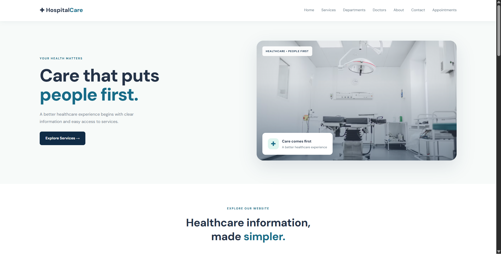
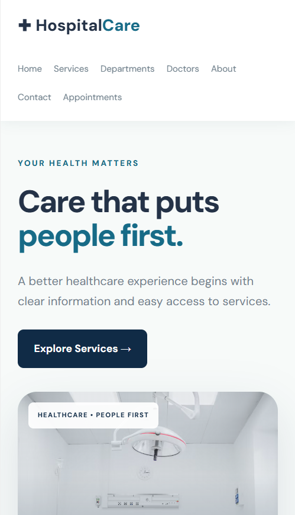

# HospitalCare
Responsive hospital website redesign concept built with HTML, CSS and JavaScript
# 🏥 HospitalCare — Hospital Website Concept

HospitalCare is a responsive hospital website concept created to practice front-end web development using HTML, CSS, and JavaScript.

## 🌐 Live Demo

- **Website:** https://fyroah-07.github.io/HospitalCare/
- **Portfolio:** https://fyroah-07.github.io/HospitalCare/portfolio.html

## ✨ Features

- Responsive website layout for desktop and mobile
- Clean, user-friendly design
- Navigation between website sections
- Appointment form for demonstration purposes
- Portfolio page with desktop and mobile screenshots

## 🛠️ Technologies Used

- HTML5
- CSS3
- JavaScript
- GitHub Pages

## 📸 Screenshots

### Desktop Homepage

### Mobile Layout

## 🎯 Project Goal

The goal of this project was to practice building and publishing a responsive website and improve my front-end development skills.

## ⚠️ Disclaimer

This is an independent, unofficial website concept created for learning and portfolio purposes. It is not an official hospital website. The appointment form is for demonstration only and does not book real appointments or submit patient information.

## 👩‍💻 Author

GitHub: [@FYROAH-07](https://github.com/FYROAH-07)
